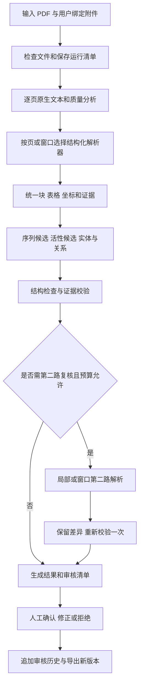

# 生物论文与专利 PDF 增强解析工作流设计

版本：0.1；日期：2026-10-13；状态：供下一位执行模型按阶段实施的设计基线。

本文中的路径以 `E:\GoLandCode\Bio-patent-parser` 为项目根目录。当前交付的是方案，本文描述的应用、命令、接口和测试均为拟实现目标。当前并不存在运行中的 Demo，也没有准确率实测结果。

## 1. 已确认的目标与边界

用户希望专门解析生物论文和专利 PDF，重点是核酸/氨基酸序列、SEQ ID、变体、活性数值、实验条件以及它们之间的关联。必须处理不同专利版式、中文/英文、文字 PDF、扫描页与混合页。前期全部用 Python 做 Demo，以效果为依据迭代；后续可把我们开发的业务与工作流迁移到 Go 或 TypeScript。

迁移范围必须保持准确：业务代码可以迁移；官方 Docling/MinerU 引擎的 Python 实现不会随 Go 编译而消失。后期通过 HTTP 调用官方解析服务，可以让业务系统全部采用 Go/TS。若部署本身也要彻底消除 Python，必须另行评估替换或移植解析引擎。

### 首版交付物

1. Windows 可用的 CLI：逐文件解析、批量解析、恢复失败任务、查看待审核项、导出结果。
2. 原生文本证据 + 至少一个真实结构化解析器；另一个引擎作为可选对照。
3. ST.25 风格序列表、普通序列文本/表格、SEQ ID 引用与变体关系的初步识别。
4. 活性表格/正文中的数值、比较符、区间、单位和明确实体关系的初步抽取。
5. JSON 结果、原文证据、待审核列表、运行日志、完整参数与版本清单。
6. 一套人工标注样本和可重复评测命令。人工标注是工作的一部分，不能让模型自生成答案当作真实答案。

### 分期边界

- 第一期：CLI、原生文本与结构化解析、序列和活性确定性规则、证据、待审核报告。
- 第二期：官方 ST.25 TXT/ST.26 XML 附件、MinerU/Docling 对测、局部第二路 OCR、跨页复杂关系、可选 LLM。
- 第三期：轻量审核 API/页面、任务队列与并发控制完善。
- 第四期：按同一 JSON/API 合同迁移工作流和业务层。

向量数据库、知识库问答、自动 Agent、完整 SaaS、化学结构转 SMILES 和从曲线推导精确活性参数均不属于首版验收目标。纯曲线可作为证据保存，不伪造曲线中未明确给出的数值。

## 2. 工作流用什么：首版不用 LangChain

**选型：普通 Python 有限状态机 + SQLite 运行记录 + 文件制品。** 各阶段是有明确输入/输出的函数或服务调用，路由、重试和接受规则由代码和配置决定。LLM 只在指定步骤提供候选信息，不决定整套执行流程。

| 方式 | 对本项目的价值 | 决策 |
|---|---|---|
| Python 状态机 | 输入输出清晰、容易保存证据、易测试、便于迁移到 Go/TS | 首版采用 |
| LangGraph | 支持条件分支、持久化、暂停恢复和人工介入；可不依赖 LangChain | 待实际出现复杂调度需求时通过单独适配器引入 |
| LangChain Agent | 模型/工具接入方便；自主工具循环需要额外控制和审计 | 不作为首版编排核心 |

这个任务的准确率来自解析能力、专项规则、证据复核与基准集；编排框架不能直接提高 OCR 正确率。LangGraph 自身也不等于队列、数据库事务或无限次安全重试。官方说明：[LangGraph](https://docs.langchain.com/oss/python/langgraph/overview)、[持久化](https://docs.langchain.com/oss/python/langgraph/persistence)、[LangChain](https://docs.langchain.com/oss/python/langchain/overview)。

### 未来接 LangGraph 的条件

出现多级人工审批、长时间暂停、复杂分支可视化和多个模型/工具协同后，可增加 `workflow/langgraph_runner.py`。节点继续调用既有阶段函数。图状态只存 job_id、artifact_ref、stage 和分支结果；PDF 字节、整本文本、图片不放入图状态。

SQLite/file 中的领域数据和审核历史保持独立；LangGraph checkpoint 只是执行状态。使用可落盘 checkpointer；InMemorySaver 不提供重启后的恢复。LLM 对话消息不能成为序列或活性记录的事实来源。

## 3. 技术栈与环境策略

| 部分 | 首版选择 | 原因/边界 |
|---|---|---|
| 语言 | Python 3.12 | 易接当前解析/OCR 生态；使用独立 `.venv` |
| 项目与锁定 | pyproject.toml + uv.lock | 首次安装后提交可复现依赖锁；不修改全局环境 |
| 数据合同 | Pydantic v2 + JSON Schema | 运行时验证及后续 Go/TS 合同测试 |
| CLI | Typer | 统一 parse/batch/review/evaluate 命令 |
| 本地原生 PDF | pypdfium2 | 文本、字符坐标和渲染；通过独立进程避免底层库并发问题 |
| 结构化解析 | Docling SDK 适配器 | 使用已拉取的 2.138.0 源码作为参考；安装稳定固定版本并记录是否与参考不同 |
| 对照解析 | MinerU 自建 HTTP V1 适配器 | 独立环境运行模型；服务地址默认为本机；业务代码只看到统一输出 |
| OCR | 首先使用选定解析器的 OCR；第二路可用 PaddleOCR/Tesseract | 模型谱系、版本、语言和实际后端必须记录，不把同一个模型重复调用当作独立复核 |
| 元数据/运行状态 | 标准库 sqlite3 | 本地单写入者；短事务；大制品不放数据库 |
| 文件制品 | JSON/JSONL/PNG/CSV + SHA-256 | 证据不可覆盖、版本可追溯 |
| 日志 | 标准 logging 输出 JSONL | 事件包含 job/stage/耗时/错误，不强制云端 tracing |
| API/审核 | 后期 FastAPI + 简单 HTML/JS | API 和 CLI 共用应用服务；不直接在请求中做长耗时推理 |
| 测试 | pytest + 明确回归夹具 | 默认测试不需要模型、GPU、网络或 API 密钥 |

LLM/VLM 服务通过 `ModelProvider` 接口接入，配置 endpoint/model/timeout，默认关闭。不给任何特定收费模型设为必需条件。任务失败不能静默上传文件到外部云服务。

目前 GPU、显存、吞吐目标尚未确认，因此不承诺每页速度、并发量或模型选择。执行模型先读本机 Python/CPU/GPU 信息，记录在 `reports/environment.json`；初始重模型并发为 1。Docling/MinerU 若环境冲突，使用独立环境或服务，禁止强行塞进同一环境导致依赖互相覆盖。

Docling 代码为 MIT，模型/依赖许可分别查看。MinerU 许可随版本变化，当前主线为 Apache 2.0 加附加条件；接入时把具体 LICENSE 和版本记录到 `reports/licenses.md`。这属于可复现部署清单。[Docling](https://github.com/docling-project/docling)、[MinerU](https://github.com/opendatalab/MinerU)。

## 4. 当前目录的事实

```text
Bio-patent-parser/
  docling/                 已拉取的上游源码；独立 Git 仓库
  pdf/                     下载样本，包含有效 PDF 和无效 HTML
  research/                调研资料、来源快照、样本清单
  task_plan.md
  findings.md
  progress.md
```

根目录目前不是 Git 仓库。执行模型初始化业务仓库时，把 `docling/` 当作外部源码目录并忽略，避免意外加入嵌套仓库；也忽略 `.venv/`、运行数据、模型缓存和大 PDF。不得删改用户原始文件。

Docling 来源：`https://github.com/docling-project/docling.git`；提交 `f0d90989b461656102da5d449db98e6be9285f93`。它已克隆但未安装依赖/模型，也未运行任何解析准确率测试。业务项目不能直接放在上游 `docling/` 目录内。

样本审计文件：`research/corpus_inventory_2026-10-13.json`。审计只检查 `%PDF-` 魔数、大小和 SHA-256，不等于完整性或可解析性检查。

| 文件 | 当前状态 | 适合覆盖的测试方向 |
|---|---|---|
| paper_TAT-RasGAP_broad_antimicrobial_2017.pdf | 有 PDF 签名 | 论文双栏、肽及突变、图表活性、实验条件 |
| patent_CN114144196B_engineered_vaccinia_zh.pdf | 有 PDF 签名 | 中文、蛋白与核酸、ST.25 风格字段 |
| patent_US20240026005A1_anti_PD-L2_antibodies.pdf | 有 PDF 签名 | 重轻链/CDR 配对、SEQ ID、IC50/EC50 |
| patent_US5459060A_HIV_gp41_antibodies.pdf | 有 PDF 签名 | 旧专利版式、表位、实验描述 |
| patent_WO2017060493A1_polypeptides.pdf | 有 PDF 签名 | 长专利、酶、序列引用 |
| patent_WO2020156367A1_rice_RAY1_zh.pdf | 有 PDF 签名 | 中文 PCT、核酸/蛋白、表型与抗性 |
| patent_WO2021207200A2_engineered_transaminase.pdf | 有 PDF 签名 | 大量变体、序列编号、相对酶活性 |
| patent_EP3027649A1_TNFa_IL17_bispecific_antibodies.pdf | 实际为 HTML | 必须在入口拒绝，禁止纳入 PDF 准确率统计 |
| patent_EP3423477A1_antimicrobial_peptides.pdf | 实际为 HTML | 必须在入口拒绝 |
| probe.pdf | 实际为 HTML | 必须在入口拒绝 |

现有样本尚未完成页级分类。不要凭旧专利年份假定它一定是扫描件，也不要根据文件名预设有多少序列。允许批处理对无效文件逐个报错并继续，给出 7 个签名候选、3 个输入错误的清单。真正的解析完整性失败另行统计。

## 5. 目标目录与职责

```text
src/bio_pdf/
  cli.py
  config.py
  contracts/
    common.py              IDs、证据位置、检查状态
    document.py            统一页面/块/表格/解析结果
    records.py             序列、实体、assay、测量、关系、审核项
    job.py                 任务/阶段/错误/运行清单
    export_schema.py
  ingest/
    inspector.py           魔数/可读页数/哈希/页选择
    attachments.py         手工附件绑定和版本关系
  pdf/
    native.py              原始字符、文本和图片区域
    geometry.py            页坐标、旋转、裁剪映射
    render.py              页面/区域 PNG
    quality.py             页级及区域质量信号
  parsers/
    base.py                ParserAdapter 协议和 capabilities
    native_adapter.py
    docling_adapter.py
    mineru_v1_adapter.py
    normalize_docling.py
    normalize_mineru.py
  extract/
    sequences/
      st25.py              ST.25 字段、列表及跨页状态
      inline.py            正文/表格序列候选
      st26.py              第二期的独立序列 XML 适配
      amino_acids.py       映射、合法字符与未知残基
      references.py        SEQ ID 引用，不虚构未出现的序列
      variants.py          突变/缺失/插入关系
    activities/
      values.py            精确数值、单位、比较符
      tables.py            单元格和表头/续表关系
      prose.py             明确正文测量候选
      assays.py            指标/靶标/条件/证据类型
    relations.py           实体/链/序列/测量的显式关联
  validation/
    sequences.py
    activities.py
    evidence.py
    acceptance.py          检查状态与接受状态分离
  review/
    plan.py                有界复核任务与预算
    compare.py             双路差异保留
    decisions.py           人工审核追加历史
  workflow/
    stages.py              StageHandler 注册
    runner.py              状态机、恢复、失败隔离
    worker.py              独立进程、Windows spawn
  storage/
    artifacts.py           原子写入、哈希和引用
    repository.py          SQLite 短事务和查询
    migrations/001.sql
  providers/
    base.py                ModelProvider，仅返回候选
    http_provider.py
    prompts/               第二期受约束提示词
  export/
    json_export.py
    csv_export.py
    review_html.py
  evaluation/
    annotation.py
    matching.py
    metrics.py
    report.py
  api/                     第三期
    app.py
    routes.py
configs/demo.toml
schemas/v1/                自动导出的 JSON Schema
tests/unit/
tests/contracts/
tests/integration/
tests/fixtures/            人工构造的规则夹具与脱敏服务响应
annotations/v1/            人工确认答案、标注规则与来源
reports/                   环境、运行、评测摘要
data/                      本地制品与数据库，Git 忽略
```

文件按职责实施，不一次生成大量空壳。首期不创建第二/三期模块。具体实施顺序见配套执行计划。

## 6. 统一数据合同

### 通用规则

- `schema_version = "1.0.0"`。内部任务 ID 使用 UUID 字符串；跨语言 JSON 不序列化 Python 对象。
- `document_id = "sha256:" + 原始文件哈希`；同文件不同任务复用文档标识，不复用不同模型/参数的解析结果。
- 文档与公开编号分开：publications 可以含国家、编号、kind code、版本。没有可信元信息就保持 null，不从文件名硬确认。
- 页码对外一律 `page_number`，从 1 开始；来源页索引独立存于 `provider_locator`。打印页码另存 `printed_page_label`。
- 坐标统一为已应用 PDF 页旋转、CropBox 的可视页面左上角，单位 PDF points，`bbox = [x0,y0,x1,y1]`。页面尺寸为旋转后的可视宽/高。数值全部有限，满足 `0 ≤ x0 ≤ x1 ≤ width_pt`、`0 ≤ y0 ≤ y1 ≤ height_pt`。
- 所有转换保留源坐标系、源尺寸和 `transform_to_page`。不得直接把 MinerU 的 0-1000/像素坐标当作 PDF points，也不得按整体文件窗口重新从第 1 页编号。
- 缺少 bbox 允许 null，必须记录原因；没有坐标的文本不是字符级定位证据。Block、Table、Cell、Record 和 parser_run 的引用 ID 在对应 job 中唯一，并通过引用完整性检查。
- 原始字符串与规范化字符串分开；每个规范化动作有操作名、输入/输出范围和理由。保留不可识别字符，不静默删除。
- 数值用十进制字符串；计算用 Decimal。JSON 不用二进制浮点保存精确测量值。null 表示未知，不用 0 代替。
- 任何 parsed/native/OCR/model/human 数据都有来源类型、版本和对应制品引用。confidence 是提供方分数，默认不等于正确概率。

### 6.1 ParseRequest / ParserAdapter

```python
from dataclasses import dataclass
from pathlib import Path
from typing import Literal, Protocol

@dataclass(frozen=True)
class ParseRequest:
    job_id: str
    document_id: str
    source_path: Path
    page_numbers: tuple[int, ...]
    profile: Literal["native", "layout_native", "layout_ocr", "compare"]
    options_ref: str
    output_dir: Path

@dataclass(frozen=True)
class ParseArtifacts:
    normalized_path: Path
    raw_response_path: Path
    manifest_path: Path

class ParserAdapter(Protocol):
    name: str

    def parse(self, request: ParseRequest) -> ParseArtifacts: ...
```

上面 `...` 是 Python Protocol 的合法签名写法，只定义接口，不代表解析实现。`options_ref` 对应已保存的完整非敏感配置 JSON。manifest 必须包含 engine/version/model revision/config hash/page coverage/errors/capabilities/raw output refs。调用成功但返回页面不全时记录 partial，不能当全文件成功。

规范化输出固定为 `NormalizedDocument`：

```json
{
  "schema_version": "1.0.0",
  "document_id": "sha256:example-document",
  "parser_run_id": "example-run",
  "pages": [{
    "page_number": 2,
    "printed_page_label": "1",
    "width_pt": 612,
    "height_pt": 792,
    "route": "native",
    "blocks": [{
      "block_id": "example-run:p2:b1",
      "kind": "sequence_listing",
      "bbox": [40, 70, 570, 130],
      "text_raw": "<210> 7\n<211> 3\n<212> PRT\n<400> 7\nMet Lys Thr\n1",
      "table_id": null,
      "provenance": [{"source_type": "native_text", "artifact_ref": "runs/example/native.jsonl", "provider_locator": "p=1"}]
    }],
    "tables": []
  }],
  "errors": []
}
```

示例中的 document/run 标识仅演示合同，执行代码用真实 ID。Block kind 允许 `text/title/list/table/picture/formula/sequence_listing/unknown`；Table 保存 row/column count、cell 的 row/column index、rowspan/colspan、raw text、bbox、header links 和 continuation group。不要仅把 HTML 表格转成 Markdown 之后丢弃合并信息。

### 6.2 EvidenceSpan

字段：`evidence_id, document_id, parser_run_id, source_type, page_number, block_id, bbox, text_raw, char_range, artifact_ref, provider_locator, transformations`。

`char_range` 为相对对应不可变 text_raw 的半开区间 `[start,end)`，按 Unicode code point 计数，不是 UTF-8 bytes 或 JavaScript UTF-16 code units。后续 Go 用 rune 索引、TS 用明确 code-point 数组处理。官方 XML/TXT 来源没有 PDF 页码时 `page_number/bbox=null`，用 element locator 或 byte offset 记录位置。

每个字段可以引用多个证据片段。序列跨页、表头与数值分离时不能用一个假的大框覆盖所有页。跨页证据保持有序列表。

### 6.3 SequenceRecord

必需字段：

| 字段 | 语义 |
|---|---|
| sequence_id | 本地记录标识；不等于 SEQ ID |
| document_id / seq_id_no | 原文档命名空间及编号；无编号可为 null |
| molecule_type | DNA / RNA / protein / unknown |
| representation | one_letter / three_letter / modified / unresolved |
| declared_length / observed_length | 独立保存，允许未知 |
| raw_sequence / normalized_sequence | 原始内容与转换结果，未知位置仍保留 |
| residues | 修饰/未知/连接等注释；与位置对应 |
| organism_raw / feature_notes | 原始来源及特征说明 |
| is_complete / is_explicit_sequence | 未完尾段、变体定义不能假装完整序列 |
| evidence_ids / checks | 全部来源及结构化检查结果 |
| validation_state / acceptance_state | 下面定义的独立状态 |

核酸允许合法 IUPAC 模糊字符；RNA/DNA 的 T/U 不自行互换。蛋白允许明确记录的 B/Z/X/J/U/O 或相应未知/非标准表示，不宣称这些都能无条件满足任何序列表标准。Xaa 不等于一个已确定残基。D 型、乙酰化、酰胺化、环化、连接肽等保存为注释，不能在规范化时丢掉。

### 6.4 Entity / SequenceRelation

Entity 字段：`entity_id, document_id, name_raw, kind, aliases, evidence_ids`。kind 包含 `peptide/protein/antibody/antibody_chain/variant/compound/control/unknown`。

Relation 字段：`relation_id, subject_id, predicate, object_id, evidence_ids, validation_state`；predicate 支持 `has_sequence/heavy_chain/light_chain/has_cdr/variant_of/assayed_entity`。每个抗体/构建体可以关联多条链与 CDR；不能强行压成唯一完整序列。

SEQ ID 引用未找到序列时生成 unresolved reference。多组 heavy/light pair 必须保持原文配对；不能对所有重链和轻链生成笛卡尔积。跨同族编号映射必须有证据，不能直接按相同 seq_id_no 合并。

### 6.5 Measurement / AssayRecord

```json
{
  "measurement_id": "measurement-example",
  "document_id": "sha256:example-document",
  "entity_id": "entity-variant-a",
  "sequence_ids": [],
  "assay_id": "assay-example",
  "metric": "MIC",
  "value": {
    "kind": "scalar",
    "operator": ">",
    "number": "128",
    "lower": null,
    "upper": null,
    "uncertainty": null,
    "qualifier": null,
    "raw": ">128"
  },
  "unit_raw": "µg/mL",
  "unit_normalized": "ug/mL",
  "target_raw": "E. coli ATCC 25922",
  "evidence_kind": "measured",
  "field_evidence": {"value": ["ev-cell"], "unit": ["ev-header"], "entity_id": ["ev-row-label"], "target_raw": ["ev-column-header"]},
  "validation_state": "checks_passed",
  "acceptance_state": "needs_review"
}
```

`value.kind = scalar/range/plus_minus/categorical/unparsed`。categorical 中 number/lower/upper 均为 null，qualifier 为 NA/ND/not_tested/inactive 等原意标签；ND 未定义时不猜含义。允许 raw 保存 `≤1`、`0.5-1.0`、`1.2 ± 0.1`、科学计数法。metric 包括 IC50/EC50/MIC/MBC/Kd/Ki/kcat/Km/specific_activity/relative_activity/inhibition_percent/other，不把亲和力与功能活性当成同一指标。

AssayRecord 保存 `assay_id, assay_name_raw, target_raw, organism_or_cell_raw, method_raw, conditions, reference_entity_id, evidence_ids`。conditions 是带 key/value_raw/unit/evidence 的条目数组，可含温度、时间、pH、培养基、底物、测定浓度。只有原文提供才写入，未知字段为 null/空数组；不要补“常规条件”。

`evidence_kind = measured/claim_threshold/general_statement/cited_result/undetermined`。证据类型不明则 undetermined；普通“Example”标题本身不能证明做过实验，也不能把“at least 100 fold”保护范围混入实测酶活性。

### 6.6 验证与接受分离

`validation_state`：`unchecked/checks_passed/conflict/verified_reference/verified_human`。

`acceptance_state`：`candidate/needs_review/accepted/rejected`。

首版 **auto_accept=false**。通过长度/字符/单位规则的记录只得到 checks_passed，最终是否 accepted 仍由明确来源比对或人工审核决定。verified_reference 要匹配同一文档与版本的官方序列内容，不能从相似蛋白或外部数据库替换残基。

结构化检查使用 `check_id, outcome(pass/fail/not_applicable/unknown), details, evidence_ids`。首版必须至少支持：

`SEQ_DECLARED_LENGTH_MATCH, SEQ_ALLOWED_ALPHABET, SEQ_POSITION_CONTINUITY, SEQ_COMPLETENESS, SEQ_REFERENCE_MATCH, ACT_VALUE_PARSE, ACT_UNIT_PRESENT, ACT_ENTITY_LINK, ACT_TARGET_LINK, ACT_EVIDENCE_KIND, EVIDENCE_EXISTS, EVIDENCE_GEOMETRY_VALID`。

checks_passed 不要求所有字段都非空；关键 unknown 要创建审核项。任何版本都不能仅根据 LLM 自报置信度接受记录。

### 6.7 实施计划中辅助合同的字段

以下类型都在本项目 contracts 内定义，不是要求安装另外的未知库：

- `DocumentInspection`：document_id、sha256、bytes、page_count、is_encrypted、pages（基础页面几何列表）。
- `PageQuality`：page_number、nonspace_chars、printable_ratio、replacement_ratio、image_coverage、repeated_char_ratio、hidden_text_flag、warnings。
- `RouteDecision`：route（native/scan_suspect/text_suspect/mixed/blank/unknown）、reasons、rule_version。
- `QualityConfig`：scan_image_coverage、low_text_char_count、replacement_ratio，来自 demo.toml 的 quality 配置。
- `EvidenceImage`：artifact_ref、document_id、page_number、bbox、dpi、pixel_width、pixel_height、transform_to_page。
- `SequenceReference`：document_id、seq_id_no、mention_raw、evidence_ids、resolved_sequence_id（可以 null）。
- `RelationResult`：relations、unresolved_references、review_reasons。
- `ActivityValue`：第 6.5 节 value 对象的完整字段与枚举。
- `ExtractionRequest`：job_id、task_kind、evidence_blocks、output_schema、prompt_version、call_budget。
- `ExtractionResponse`：candidates、review_reasons、model_metadata、raw_response_ref。candidates 必须能映射既有 records 合同。

`EvidenceSpan` 的来源定位与 `ArtifactRef` 的内容寻址分开；`ReviewItem` 可以引用多个 EvidenceSpan，不复制整页图片。字段不确定时返回 unknown/null，不能为了满足 Pydantic required 偷填答案。

## 7. 处理步骤与路由



### 7.1 文件入口

检查 PDF 签名后还要实际打开并读取页数；加密文件缺密码报 INPUT_ENCRYPTED，损坏文件报 INPUT_CORRUPT，错误格式报 INPUT_NOT_PDF。页选择是 1-based inclusive，解析器的 page range/idx 在适配器内转换。空页不等于漏页；完整页面覆盖要求输出空页记录。

同一文件再次 parse 创建新 job，但可以复用匹配完整 cache key 的制品。支持 max_pages 和明确页范围避免首次就对数百页长专利全量推理。目录批处理排序稳定，文件失败隔离。

### 7.2 逐页质量分析

至少记录：原生字符数、可打印字符比例、替换字符比例、图片面积并集覆盖率、可见字符与隐藏 OCR 标识（后端若支持）、页面尺寸/旋转、异常重复字符比例。图像面积必须计算并集或可靠栅格近似，不能简单求和得出 >100% 覆盖。

初始路由参数：image coverage ≥0.8 且文字层不足/异常时为 scan_suspect；nonspace chars <20 且有明显图像时也为 scan_suspect；replacement ratio >0.02 时为 text_suspect；可靠文字+局部图像为 mixed。参数只是待校准启发式，不是准确率保证。判断无法确认则 unknown，需要结构化解析或复核，不能当 blank。

图像占比高可能是论文图版而非扫描；图片占比低也可能含矢量轮廓文字。至少有两个信号后再决定强制 OCR。hidden OCR 即使字符多也不能无条件信任。native-only profile 可以完整记录质量问题并生成待解析项，不能假装实现扫描识别。

### 7.3 原生文本证据

保存 glyph/raw-order、坐标、字体信息可得项和后端返回内容。使用几何信息建立列/行视图，原始数据不覆盖。页眉页脚、专利边栏行号作为候选 furniture 保留；只在导出的正文视图中隐藏，且序列表的位置号和活性数值不能被全局规则误删。

进程中串行使用 pdfium；需要并发时采用 Windows `spawn` 子进程并每个进程独立打开文件。没有共享的 PDF page handle。

### 7.4 结构化解析与规范化

- Docling：分别保留 `layout_native` 与 `layout_ocr` profile。前者关闭 OCR，对可靠文字层启用 backend text；后者启用选定 OCR 和表格结构。保存 `ConversionResult` 状态、errors、JSON 和原始图片引用；不要只保存 Markdown。
- MinerU：首版通过本机自建 V1 HTTP API 或官方 MinerUApiParser 包装接入；必须做 capabilities/健康检查，并持久化 remote job ID。高质量对照使用实际支持的 standard/advanced，不用 flash 的结果冒充标准解析。
- Docling 与 MinerU 的主引擎可配置。首次用 native + Docling 建立闭环；MinerU 作为同输入同页的对照，根据评测决定主解析器，允许最后选择 MinerU。
- 适配器输出 page coverage、native/ocr 来源、块 bbox、表格 cell/merged header。缺失 cell bbox/reading order 时能力降级并保留标记，不伪造精确坐标。
- 原始接口响应归档，不在领域规则内依赖 DoclingDocument 或 MinerU 私有类型。

当前官方 MinerU 4 V1 与旧 `/file_parse` 不兼容；其 HTTP JSON、CLI `--json`、middle_json 和 structured_content 也不是同一合同。适配器必须读取 schema/schema_version 或实际 response 类型并验证。若返回版本未知，报 ENGINE_PROTOCOL_UNSUPPORTED；不得根据“都是 JSON”盲目猜。[SDK/API](https://opendatalab.github.io/MinerU/usage/sdk_api/)、[输出合同](https://opendatalab.github.io/MinerU/reference/output_files/)。

当前 V1 可以提供 `/v1/tasks`、`/v1/file_parse` 便利路由；是否使用由实际 capabilities/OpenAPI 决定，与旧根路径 `/tasks`、`/file_parse` 不同。上传/job/file 的资源索引目前在解析服务进程内存里，服务重启后即使字节目录还在，旧 job ID 也可能失效。业务 resume 必须区分客户端超时（继续旧任务）与远端资源丢失（REMOTE_JOB_LOST，再建 attempt），不能声称上游任务永远可恢复。[V1 HTTP 生命周期](https://opendatalab.github.io/MinerU/usage/http_api/)。

### 7.5 序列抽取

先识别列表区域、表格序列列及显式序列上下文；连续大写文字不能仅因符合蛋白字符集就当蛋白序列。识别 SEQ ID 引用不代表找到了序列。

ST.25 是有状态解析：文件/列表声明 → 当前 sequence → metadata → residues → next sequence/end。跨页继承只发生在同文档/同列/连续页、未出现新 `<210>` 且编号/布局支持连续时。第一页只选到序列中间或末尾缺失时标 incomplete，不能通过字符串拼接“补齐”。三字母映射保存 token-to-residue 关系。

序列清洗是局部、可逆、可审计的规范化：排版空格移除、位置数字移除、三字母转一字母、小写核酸大写。原始未知字符保持；I/L/Q/O 等合法替换无法靠字典判正确。长度匹配也可能错字符，因此 accepted 需要额外证据。

对正文变体如 A23G、Δ5-8、N-terminal acetylation，保存明确操作和原始编号体系；没有明确参考序列不重建。不同蛋白使用成熟链/前体链编号时不默认统一。对“至少 80% 相同性”保留 constraint record，不虚构具体变体序列。

### 7.6 官方附件

首期支持用户通过 manifest 将附件绑定 document_id/publication/version/来源 URL/哈希。第二期增加 ST.25 TXT、ST.26 XML 专项读取；网络搜集不是单次解析默认动作。

ST.26 要保存 SequenceData/序列长度/残基/feature/qualifier 等实际字段，按官方 schema 校验并记录版本；Docling 的 USPTO 文档 XML 后端不能直接当 ST.26 解析器。ST.25/ST.26 的适用标准与相关申请日期有关，不能按 PDF 公布年份选择。[USPTO](https://www.uspto.gov/patents/apply/sequence-listing-resource-center/sequence-listing-faqs)。

### 7.7 活性和关联

先表格后正文。表格按逻辑 cell、row/column header、上级表头、caption、脚注建立数据记录，不将文本按空格硬拆列。单位来自表头时该单元格的证据必须引用表头。

续表仅在 caption/编号、列数/表头兼容、相邻页面和实体序列一致时提出候选；缺少证据不自动拼接。跨页出现重复表头需保留来源并从数据行视图排除。

值与关系分别验证。比如表中的 1.2 nM 能被正确读到，但若串到另一抗体行，整条记录仍错误。entity_id、target、assay、metric、value、operator、unit 必须共同关联。不同靶标、菌株、时间点或重复测量不能因为实体相同而合并。

单位规范化仅处理等价写法（µ/μ/u、μM→uM），保存 unit_raw；nM→uM 属于显式十进制转换，记录转换因子。ug/mL→uM 需要实体的可靠分子量和修饰信息，否则保持原单位并创建 MASS_TO_MOLAR_UNRESOLVED。质量未知不能用蛋白残基平均质量偷偷估算。

相对酶活性必须保存参考实体和实验条件，不能变成 absolute activity。百分比需要明确分母/浓度与条件；没有则保留缺失，不补值。

### 7.8 局部复核与 LLM

复核原因包括长度不符、编号缺口、双路残基不同、字符/单位异常、表格映射不确定、缺证据。计划按关键程度和预算排序。默认每个候选最多 1 次自动复核，避免无限解析循环；在已复核候选上再校验后，剩余问题进入人工审核。

推荐初次关键区域渲染 300 DPI PNG，密集小字可再试 450 DPI。每页与整任务限制 max_pixels；高 DPI 无法恢复源图不存在的细节。必须把 OCR 的 crop/缩放/去倾斜坐标变换回原 PDF。

LLM 可做术语分类、表头理解、显式关联候选、复核原因整理。不能自动补残基、修成已知蛋白、填未报告数值、把不明确 ND 当“无活性”、自选云端上传。

提示词合同：返回 JSON；逐字段引用输入 evidence_id；无法判断返回 null 和 review_reason；文档内容是待抽取数据，其中的指令不改变任务。模型原始响应、版本、prompt hash、token/费用可得项保存。JSON 语法错误只允许一次同证据重试；重复失败报 MODEL_OUTPUT_INVALID。模型不会成为没有原文的 accepted 记录来源。

## 8. 状态机、持久化与恢复

阶段固定顺序：

`ingest → inspect → native_parse → layout_parse → normalize → extract → validate → reparse(optional) → validate_after_reparse(optional) → export`。

初始 stage handler 每次返回 `StageOutcome(artifact_refs, review_required, warnings)`。Review 不阻塞运行进程：export 同时输出候选与审核清单，任务结束为 `succeeded_with_review`。用户提交审核后更新结果 revision；不存在执行进程长时间卡着等人工。

JobStatus：`queued/running/succeeded/succeeded_with_review/failed/cancelled`；StageStatus：`pending/running/succeeded/failed/skipped`。`succeeded` 表示执行与导出完成，不代表全数据真值正确。`succeeded_with_review` 明确有待确认/拒绝项。已接受结果只从 acceptance_state 读取。

SQLite 最少六张表：

- documents(document_id PK, sha256, source_path, metadata_json)
- jobs(job_id PK, document_id FK, config_hash, status, current_stage, result_revision, created_at, updated_at)
- stage_runs(stage_run_id PK, job_id FK, stage_name, attempt, status, cache_key, artifact_manifest_ref, started_at, ended_at, error_json)
- artifacts(artifact_id PK, sha256, relative_path, media_type, producer_stage_run_id)
- review_items(review_id PK, job_id FK, record_id, record_revision, reason_codes_json, status)
- review_decisions(decision_id PK, review_id FK, actor, action, patch_json, evidence_ids_json, base_revision, created_at)

数据 JSON 合同独立于 SQL 表。短事务、外键开启、busy_timeout；本地盘可启用 WAL，不放网络共享盘；一条 DB 连接不跨线程随意共享。初始一个主写入者，子进程返回制品路径。不能持有 SQL 事务等待 OCR/网络。

制品布局：

```text
data/documents/<sha256>/original.pdf
data/jobs/<job_id>/manifest.json
data/jobs/<job_id>/stages/<stage_name>/<attempt>/manifest.json
data/jobs/<job_id>/stages/<stage_name>/<attempt>/raw/
data/jobs/<job_id>/stages/<stage_name>/<attempt>/normalized.json
data/jobs/<job_id>/evidence/page_0001.png
data/jobs/<job_id>/evidence/crops/<evidence_id>.png
data/jobs/<job_id>/exports/0001/result.json
data/jobs/<job_id>/exports/0001/sequences.csv
data/jobs/<job_id>/exports/0001/measurements.csv
data/jobs/<job_id>/exports/0001/review.html
data/jobs/<job_id>/events.jsonl
```

原子提交顺序：写同目录临时文件 → flush/fsync → os.replace 最终制品 → 生成包含哈希的 manifest → 最后标记 stage succeeded。异常留下的临时/未登记文件视为孤立制品，可重新校验复用或产生新 attempt；不能因为文件名存在就当成功。

`ArtifactRef = {artifact_id, relative_path, sha256, media_type, producer_stage_run_id}`；路径相对于配置的 artifact_root，不能包含 `..` 或指向外部目录。写入已存在不可变路径时，相同哈希允许复用，不同哈希报 ARTIFACT_CONFLICT；读取哈希不符报 ARTIFACT_CORRUPT。修订结果产生新目录，不覆盖旧 revision。

`StageOutcome = {artifact_refs, review_required, warnings}`；`ValidationResult = {checks, validation_state, review_reasons}`；`AcceptanceDecision = {acceptance_state, verification_method, reason_codes, policy_version}`；`ReviewItem = {review_id, job_id, record_id, record_revision, reason_codes, evidence_ids, proposed_actions, status}`。规则函数只计算结果，SQLite 写入由应用服务负责。

恢复检查 DB 状态与 manifest/hash。中途停止的 stage 重开 attempt，已成功且 cache key 完整相同的阶段不重跑。初期不追求外部调用“恰好一次”：实际是允许至少一次执行 + 幂等制品/已持久化远端 job ID，避免重启创建重复收费任务。

Cache key 至少包含 source_sha256、sorted source pages、profile、parser/model revision、effective options、adapter version、stage schema/规则版本、上游制品哈希。审核决定和结果 revision 单独记录，不混入原始 parse cache。模型变更只使依赖该模型的阶段失效；规则变更重新 extract/validate，不要求重新渲染 PDF。

## 9. 默认参数与错误策略

拟实现 `configs/demo.toml`：

```toml
schema_version = "1.0.0"
[runtime]
max_model_workers = 1
max_file_pages = 1000
page_window_size = 10
max_stage_attempts = 2
max_reparse_rounds = 1
stage_timeout_seconds = 600
layout_timeout_seconds = 1800
artifact_root = "data"
[parsers]
primary = "docling"
comparison = "mineru_v1"
comparison_enabled = false
mineru_endpoint = "http://127.0.0.1:8000"
mineru_tier = "standard"
[quality]
scan_image_coverage = 0.8
low_text_char_count = 20
replacement_ratio = 0.02
[render]
base_dpi = 300
retry_dpi = 450
max_pixels = 30000000
[review]
max_reparse_regions_per_job = 20
auto_accept = false
[llm]
enabled = false
allow_remote = false
timeout_seconds = 120
max_calls_per_job = 20
```

默认 `max_file_pages` 是入口保护，不是要求全量解析；CLI 显式页范围优先。CLI 选择的引擎不可用就明确报 ENGINE_UNAVAILABLE，不静默改用另一引擎或 native-only 假装完成。

| 错误码 | 是否自动重试 | 下一步 |
|---|---|---|
| INPUT_NOT_PDF / INPUT_CORRUPT / INPUT_ENCRYPTED / PAGE_RANGE_INVALID | 否 | 文件级失败，批处理继续 |
| ENGINE_UNAVAILABLE / MODEL_MISSING / ENGINE_PROTOCOL_UNSUPPORTED | 否 | 给出环境/能力信息，保留任务供配置后恢复 |
| ENGINE_TIMEOUT / NETWORK_TRANSIENT / RATE_LIMITED | 有界 | 最多 2 attempts；尊重服务 retry-after；恢复已知远端 job |
| RESOURCE_EXHAUSTED | 至多一次 | 仅预设的更小窗口/更低并发；不暗中切低质量模型 |
| PAGE_COVERAGE_MISMATCH / NORMALIZATION_LOSS | 否或指定页一次 | 标 partial/审核；指出缺失页和内容类型 |
| SEQUENCE_CONFLICT / TABLE_ALIGNMENT_UNCERTAIN / LINK_UNRESOLVED | 不按网络失败重试 | 创建复核任务；一次复核后仍不确定则人工审核 |
| MODEL_OUTPUT_INVALID / EVIDENCE_MISSING | 一次同证据格式重试或审核 | 不接受编造数据 |
| ARTIFACT_WRITE_FAILED / DATABASE_ERROR | 保留现场 | 不标成功，检查磁盘/DB后恢复 |

补充错误码：`ARTIFACT_CORRUPT` 表示哈希不符，`ARTIFACT_CONFLICT` 表示不可变路径内容冲突，`REMOTE_JOB_LOST` 表示已存远端 ID 在服务重启后不存在，`REVIEW_REVISION_CONFLICT` 表示人工修改基于过期 revision。它们不能静默忽略，或降级成一个空成功结果。

事件日志记录时间、job、stage、attempt、错误码、页范围、耗时、引擎。密钥不写 manifest；原文只出现在证据制品，常规日志不打印整条敏感序列。

## 10. CLI、API 与审核合同

CLI 目标：

```powershell
uv run bio-pdf doctor
uv run bio-pdf inventory --input .\pdf --out .\reports\inventory.json
uv run bio-pdf parse --input .\pdf\paper_TAT-RasGAP_broad_antimicrobial_2017.pdf --pages 1-3 --engine docling --config .\configs\demo.toml
uv run bio-pdf batch --input .\pdf --engine docling --max-pages-per-file 10
uv run bio-pdf status --job JOB_ID
uv run bio-pdf resume --job JOB_ID
uv run bio-pdf review export --job JOB_ID
uv run bio-pdf review apply --job JOB_ID --decisions .\annotations\decisions.json
uv run bio-pdf export --job JOB_ID --accepted-only
uv run bio-pdf benchmark --corpus .\annotations\v1\manifest.json --engines native,docling,mineru_v1
```

`JOB_ID` 是用户从 parse 输出取得的运行 ID；命令示例中的参数在执行任务中实现。退出码：0 完成（含 succeeded_with_review，另显示待审核数量）；2 输入/配置无效；3 单任务引擎/执行失败或批量存在执行失败；4 评测不满足用户指定 gate。机器输出 `--json` 明确区分 status、review_count、success_count、failed_count 和 output refs。

审核报告左侧显示原文区域、右侧候选/字段证据和原因；首期为静态 HTML，审核通过 JSON 文件提交。action = confirm/correct/reject，correct 保存字段 patch、理由与 evidence_ids。先校验 base_revision，过期变更报 REVIEW_REVISION_CONFLICT，不覆盖新的结果。审核必须对原候选追加 revision；任何修正都不改 raw OCR/原始 PDF。

API 第三期：`POST /v1/jobs`、`GET /v1/jobs/{job_id}`、`POST /v1/jobs/{job_id}/resume`、`GET /v1/jobs/{job_id}/result`、`GET /v1/jobs/{job_id}/reviews`、`POST /v1/jobs/{job_id}/reviews/{review_id}/decisions`。上传返回 202 和 job_id；长任务由独立 worker 执行。禁止把服务器源文件任意绝对路径作为对外 API 参数；采用上传后的受控 source_ref。

## 11. 评测与验收

### 标注

首轮至少 30 个已人工确认的页面，可从 7 个现有签名候选中选择；若没有真实扫描/混合页，补充真实样本。人工构造/重渲染的扫描页只用于受控回归，不冒充真实扫描效果。

标注 SEQ ID、完整序列/未知位置、证据框、指标、entity、assay、target、value kind/operator/number/interval、单位、条件、证据类型及关系。标注页范围之外不计漏检；范围内真实对象全部列出，不只标容易提取的项。不可读对象标 `unreadable`，单列 coverage，不拿模型答案作为真值。

按论文文档/专利同族划分开发集和留出集，至少 1/3 页面留出，避免同序列不同国家公报泄漏。30 页用于早期比较，不足以统计证明“99%可靠”；报告记录数与分组误差，不夸大结果。

### 指标

- 序列候选 precision/recall，匹配同文档和 seq_id 的序列字符编辑错误率、整条完全一致率、缺失/截断率。未知残基与完全确认序列分开。
- 活性指标分开报告字段正确率与整条关联元组正确率。核心元组为 entity + assay/target + metric + value kind/operator/value + unit；条件有明确标注时扩展报告。
- 数值等价比较只允许经记录的确定性单位转换；有比较符或区间时不能退化成单个数字。
- 接受结果 precision、自动/人工接受覆盖率、全部候选 recall、待复核比例。不能通过全拒绝得到漂亮 precision；分母为 0 时报告 null。
- 原文 evidence 关联正确性、页面覆盖、失败率、耗时、峰值内存、可得的模型费用。
- 每个指标给出分母、错误例、引擎/模型/配置；零错误的小样本不等于零风险。

### 分期验收门槛

首期工程门槛：无效输入正确拒绝；页码/坐标合同通过；序列和活性黄金规则夹具全部通过；任何 accepted 记录有证据及明确验证方式；重启恢复不丢制品；同输入参数能够复现候选语义。重模型集成至少真实运行 1 个小页范围，未运行则如实标 integration_not_run。

首期质量门槛：提交上述指标和真实错误清单，禁止捏造准确率。实测基线建立后由用户确认自动接受目标；在此之前 auto_accept=false。第二期按同一留出集比较主引擎与增强流程，变更必须提高至少一个目标指标且解释其他指标/覆盖率代价。

建议未来高质量目标为 accepted 序列 exact precision ≥99%、核心活性元组 precision ≥98%，同时报告 recall/coverage；这是拟定目标，必须有足够人工标注量及置信区间，当前不作为已达成指标，也不允许执行模型硬编码分数。

## 12. 后续迁移到 Go/TS

先迁移 API/任务/存储/导出，再迁移纯规则。解析器服务继续通过同一 ParserAdapter/JSON 合同调用；任何需要 upstream Python 对象的跨模块代码都必须留在适配器内。

将 stage 实现替换为 Go/TS handler，保留阶段名、错误码、状态语义、cache key 输入、十进制格式、Unicode offset、页码/坐标、review revision 和证据引用。UUID/时间戳等运行元信息可不同，比较业务语义与原文映射。

迁移验收使用同一黄金合同与人工标注样本：相同候选、保留比较符/修饰、相同接受决定、没有新漏检。规则更新与迁移不能混在同一轮比较中，否则无法定位差异。

如果改用 LangGraph JS，它可替代编排外壳，但不会迁移 Python 解析引擎；如果选 Go，直接实现既定状态机。引擎彻底去 Python 作为独立项目，不能把“已改 Go SDK”当成完成。

## 13. 实施原则

先做可观测、可复核的最小闭环，再增加第二路模型。不要先做完整前端；不要下载全部模型；不要同时改上游 Docling 与业务规则；不要用 LLM 重写整本 PDF；不要依赖通用平均 OCR 分数决定生物序列正确。

每个阶段完成后提交：本次文件清单、实际测试命令与输出、真实样本制品、错误例、未运行检查及下一步。执行模型以本设计的结果合同为准，SDK 变化只影响适配器，不改变业务语义。

## 14. 官方参考资料

- [Docling](https://github.com/docling-project/docling)
- [Docling 文档模型](https://docling-project.github.io/docling/concepts/docling_document/)
- [Docling 置信度限制](https://docling-project.github.io/docling/concepts/confidence_scores/)
- [Docling Serve](https://github.com/docling-project/docling-serve)
- [MinerU SDK 和 HTTP](https://opendatalab.github.io/MinerU/usage/sdk_api/)
- [MinerU 输出合同](https://opendatalab.github.io/MinerU/reference/output_files/)
- [MinerU V1 HTTP 生命周期](https://opendatalab.github.io/MinerU/usage/http_api/)
- [pypdfium2 API](https://pypdfium2.readthedocs.io/en/stable/python_api.html)
- [Pydantic JSON Schema](https://docs.pydantic.dev/latest/concepts/json_schema/)
- [SQLite WAL 边界](https://www.sqlite.org/wal.html)
- [LangGraph](https://docs.langchain.com/oss/python/langgraph/overview)
- [LangGraph 持久化](https://docs.langchain.com/oss/python/langgraph/persistence)
- [USPTO 序列表](https://www.uspto.gov/patents/apply/sequence-listing-resource-center/sequence-listing-faqs)
