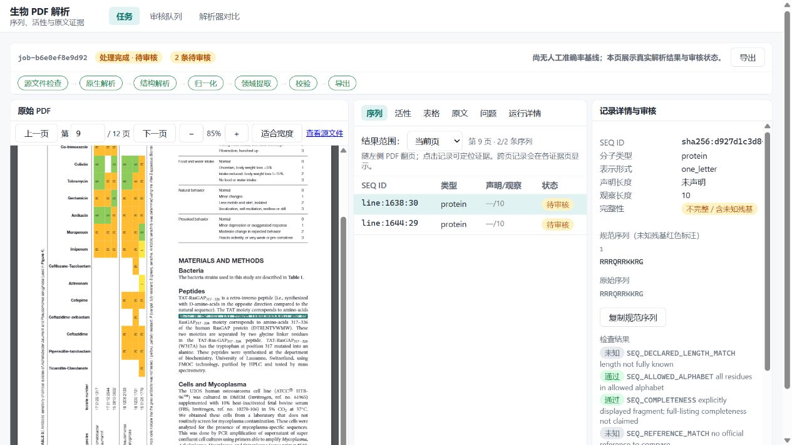
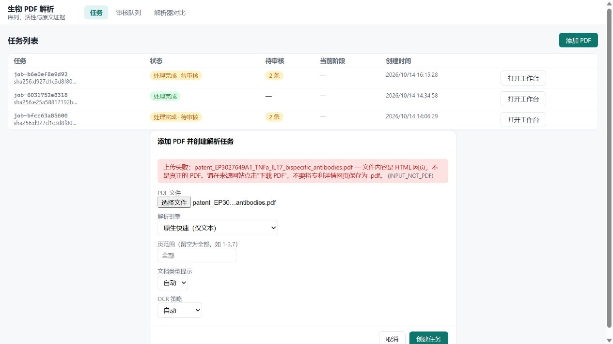

# 前端上传与页码联动修复

日期：2026-10-14。分支：`codex/scan-ocr-recovery`。运行环境：`data/post-m1-demo`，端口 8420。

## 1. 上传失败的实际原因

用户报错的 SHA-256 `c428aa2fd3cb83c7eeebe16c23b061f0d8d0c0254328a80877bb2071ced1a40a`，对应此前采集的 `patent_EP3027649A1_TNFa_IL17_bispecific_antibodies.pdf`。该文件以 `<!DOCTYPE html>` 开始，实际是 Google Patents 详情网页。另一个 EP A1 和 `probe.pdf` 同样是网页。

这些属于样本采集错误。原始文件已移至 `pdf/rejected/*.html`，原始字节和哈希保留。新增真正的 PDF，按实际 **B1 授权版本**命名，没有以 B1 内容冒充 A1：

| 文件 | 字节数 | 页数 | 上传接口 |
| --- | ---: | ---: | --- |
| patent_EP3027649B1_TNFa_IL17_bispecific_antibodies.pdf | 3372673 | 195 | HTTP 201 |
| patent_EP3423477B1_antimicrobial_peptides.pdf | 4440631 | 68 | HTTP 201 |

下载来源与版本说明见 `pdf/README.md`。两份 B1 的完整领域抽取质量尚未评测。

修复内容：

- 浏览器读取首 1024 字节，在上传前识别 HTML/空文件/缺少 PDF 文件头，并显示原始文件名和重新下载方法。
- 服务端保持 PDF 文件头及 PDFium 可读性校验，错误增加 `detected_type` 与 `file_name`，主要提示不再只有服务器内部路径。
- 换选文件、重新提交时清除旧错误；上传中禁用文件选择，避免请求对应错误的文件名。

## 2. 页码联动的实际原因

原先 PDF 页码由 `PdfViewer` 内部保存，结果区没有收到翻页事件；序列/活性展示全文，表格/原文使用另一个页码来源。只有点击记录后的证据可以驱动 PDF 跳页。

修复内容：

- 工作台统一保存 URL `page`，PDF、序列/活性筛选、表格和原文使用同一个页码。
- 默认“当前页”，支持显式切换“全部文档”；无当前页候选时提示本页为空，而不是让旧结果留在屏幕上。
- `GET /jobs/{job_id}/records` 增加 `record_pages`。页码从真实证据的顶层位置、跨页 fragments 和字段证据计算，在结果快照事务内读取，不从 ID 推断，不为缺失位置编造页码。导出快照接口保留原有行为。
- 点击记录或字段证据后根据证据 API 定位；手动翻页立即清除旧选择、详情和高亮，失效异步证据不能跳回旧页。
- 缺少位置的记录可在全文模式查看，问题与运行详情明确标为全文视图。
- 任务完成/修订号改变后重新获取结果，避免解析完成了但列表仍停留在旧缓存。
- PDF 默认适合栏宽，支持手动缩放；证据区域自动滚入 PDF 栏视野。标签不再被挤成竖排，网格宽度扣除列间距。

## 3. 实际核对记录

### 浏览器现场

使用真实论文任务 `job-b6e0ef8e9d92`：

1. 初始第 1 页：0/2 条序列。
2. 翻到第 9 页：2/2 条序列，API 映射两条记录均为 `[9]`。
3. 选择记录后翻到第 8 页：0/2 条，URL 移除 record，右侧旧详情消失。
4. 第 8 页切到全文模式：可见全部两条记录；点击第二条，PDF 跳第 9 页。
5. 原文在第 8 页显示该页 285 个块，表格视图翻到第 9 页同步使用该页接口（该 native 任务没有结构化表格，界面如实提示）。
6. 刷新包含 page=9 和 record 的 URL：恢复第 9 页、当前页两条序列、所选记录和证据高亮。
7. 默认适合宽度显示约 85%，高亮区域位于可见 PDF 栏内；结果标签保持横向。
8. 同一错误样本通过前端得到 HTML 网页提示；换选真实 PDF 后旧错误消失。
9. 从前端上传真实 EP3027649B1，指定第 1 页，创建任务 `job-7b7283ef363a` 并完成。该检查仅执行第一页面的 native 解析，不能作为 195 页全文抽取验收。

### 构建与服务

- 最终 `npm run build` 返回 0，TypeScript 和 Vite 构建完成。Vite 保留既有的静态/动态导入共存提示。
- 最终服务重启后，两个任务 records 接口 HTTP 200。
- `/api/v1/queue/status`：1 个在线 worker，0 个排队任务，0 个运行任务。
- 本次核对采用真实 API、浏览器和构建，未新增或执行自动化测试。现有论文任务没有非空活性记录，因此没有声称完成非空活性列表的实际样本验收。

### 截图

## 使用

刷新工作台即可加载新前端。上传目录中的新 B1 PDF；原来的 A1 网页已归档，不应继续作为 PDF 上传。

---

# 执行模型验收记录（2026-10-14，按 docs/superpowers/plans/2026-10-14-frontend-acceptance-and-commit.md）

## A. 逐页验收（真实 API + 浏览器，data/post-m1-demo）

环境限制：IAB webview 不产生动画帧（rAF 不触发），pdf.js 渲染依赖 rAF，观察高亮前需先截图驱动帧；Playwright 可操作性点击超时，交互改用 DOM click/事件派发。这是测试环境行为，不是应用缺陷。

| # | 项 | 结果 | 证据 |
|---|---|---|---|
| A1 | 任务列表 + 无 worker 横幅 | pass | worker 停止 16s 后，排队任务 `job-5ef2b03776b4` 显示横幅与含 `--data-dir` 的启动命令；worker 恢复后横幅自动消失、任务完成 |
| A2 | 上传对话框 | pass | 注入 HTML 头文件 → “文件内容是 HTML 网页…”+文件名；换空文件错误被替换为“文件为空”；取消关闭 |
| A3 | 序列页范围 | pass | 第 1 页 `0/2` + 页面空态提示；翻到 9 → `2/2`，URL `?page=9` |
| A4 | 选择记录与证据 | pass | URL 加 `record=`；右列详情+证据导航+审核面板；截图驱动帧后 `.evidence-box` 出现（block 级 bbox，标签“段落区域（无字符级坐标）”）|
| A5 | 带选择翻页 | pass | 翻到 8 → `0/2`、URL 移除非 record 参数、右列回到空态、高亮消失 |
| A6 | 全部文档 | pass | 第 8 页 scope=all 显示 2 条；点第二条 → PDF 跳第 9 页 |
| A7 | URL 刷新恢复 | pass | 恢复第 9 页、scope=all、所选记录高亮行、`85%` fit-width 与高亮框 |
| A8 | 活性 tab | pass（受限） | 页/全文计数与 API 一致（`0/0`），空态文案区分范围；本数据目录无非空活性记录，空列表以外的形态未实测 |
| A9 | 表格 tab（扫描件） | pass | 第 9 页 3 张表随页同步渲染（OCR 中文农艺数据，`±` 正常）|
| A10 | 原文 tab | pass | 第 9 页 130 块，页路由 layout_native，前后翻页同步 |
| A11 | 问题 tab（扫描件） | pass | 13 条 issue（state: open）与 API 一致 |
| A12 | 运行详情 tab | **fail → 修复** | 原为静态占位文案；修复后显示解析引擎/配置哈希/结果版本、阶段表（含 layout_parse 首次 `failed` 与耗时）与 21 条制品清单及下载链接 |
| A13 | 导出闭环 | pass | 打开仅 GET；POST 创建 → 轮询 completed；下载 JSON 快照 r0、2 条记录、baseline `669c093106ba0042`，与对话框“2 条记录（r0）”一致 |
| A14 | 审核队列页 | pass | 4 条 open 与 API 一致；点行跳转工作台并选中记录、证据回填页码 |
| A15 | 决定流程（job-b6e0ef8e9d92） | pass（按设计修正预期）| 确认×2 → 记录 `accepted`/`verified_human`，刷新后持久；序列 typed patch 被服务端按设计拒绝（422 `patch fields not allowed for sequence`）；过期 `base_revision` 返回 409 `REVIEW_REVISION_CONFLICT` 且 details 带 `live_revision` |
| A16 | 对比占位页 | pass | 静态说明渲染，无自动入队 |

bfcc/扫描件两个任务的审核状态在验收中未被修改（bfcc 保持 2 条待审核）。

## B. 修复与补测试

- B1 `inspector.py`：UTF-8 BOM 不再隐藏 HTML 归类；分类矩阵测试（doctype/`<html>`/大写/BOM/二进制/空）。
- B2 `result_snapshot._record_pages`：无 `evidence_id` 的 span 跳过；manifest 存在但 extract 缺失/不可读时降级为空页码而不是整个 `/records` 400；补 3 项单测（fragments 单独带页、空证据、降级路径）。
- B3 `/records` kind/q 过滤后 `record_pages` 键集合与返回记录一致（API 测试）。
- B4 上传 415 `details.detected_type/file_name`、空文件、同字节重传保留已注册源文件（API 测试）。
- B5 `useEvidence` `clear()`/`selectionKey` 用例 + `EvidenceNavigator` 组件测试（prev/next、字段按钮、精度标签不升级）。
- B6 `ExportDialog` 与工作台共享 records/job 查询键，去掉动态导入包装。
- B7（A12）`JobResponse` 增加 `config_hash`/`engine`（jobs 路由从任务配置填充）；`RunDetails` 全面改为真实数据视图。
- B8 状态标签：`succeeded_with_review` 且 `open_reviews=0` 时显示“处理完成（审核已全部处理）”。
- B9 审核面板：序列记录隐藏“修正并确认”（服务端按设计只接受测量 typed patch），改为说明“序列不可直接修改（需重新提取）”。

新增测试：pytest 431→446（+15），vitest 7→14（+7）。

## C. 验证与提交

- 全量非 live：**446 passed, 4 skipped**；`npx vitest run` 14 passed；`npm run build` 通过。
- 服务以新代码重启：`/api/v1/queue/status` 在线 worker 1；`/jobs/{id}` 返回 `engine=docling_sdk`、完整 config_hash。
- 复测：A12（引擎/阶段/制品真实渲染，截图 `screenshots/2026-10-14-run-details.png`）、B8、B9（需绕过浏览器旧 bundle 缓存确认）、A13 对话框计数——全部通过。
- 提交：`c49124c` 后端分类与 record_pages；`285a3cf` 前端页码联动/上传 UX/运行详情；本文件随文档提交。
- 观察未修（不在本轮范围）：导出快照内 `entities_note` 仍写“entities/assays land with B07”（B07 已完成，提示文案滞后）；`/reviews` 行跳转不带 scope（证据回填页码已闭环，A14 通过）。
