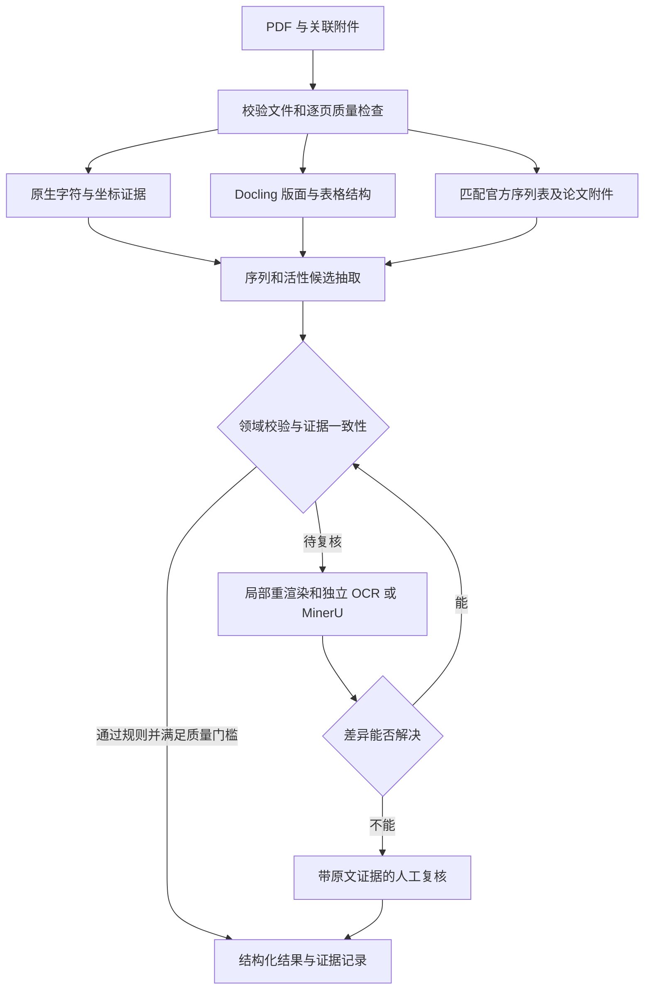

# 生物论文和专利 PDF 增强解析：选型与建议流程

日期：2026-10-13。范围：官方文档和源码调研、源码拉取、工作流建议。尚未安装解析依赖、下载模型或开展本地准确率评测。

## 结论

建议以 **Docling 为结构化解析底座，保留 PDF 原生文本作为独立证据，按需接 MinerU 或 PaddleOCR 对疑难区域复核，在上层实现专利序列与活性数据校验**。

Docling 更适合当前任务的原因是 SDK、可配置管线、结构化文档、表格单元格和原文定位，便于加入领域规则。这是工程适配性的判断，不是“在这些生物 PDF 上识别率最高”的实测结论。WeKnora 配相同解析引擎时，解析质量仍主要取决于引擎、参数及领域校验。

已克隆官方项目到 `E:\GoLandCode\Bio-patent-parser\docling`：

- origin：https://github.com/docling-project/docling.git
- 提交：`f0d90989b461656102da5d449db98e6be9285f93`
- 源码 pyproject.toml 版本：`2.138.0`
- Python 要求：`>=3.10,<4.0`
- 使用浅克隆获取当前源码，后续可以补齐历史。
- Docling 代码为 MIT；模型及依赖的许可需按实际选择分别查看。

## 1. 先纠正“字节流保证识别率”的理解

文件路径与 BytesIO 只是输入方式，输入相同字节时不会直接改变识别精度。真正的优势是从可靠文本层直接读取字符，免去视觉识别误差。

但 PDF 不一定保存自然阅读顺序或真实表格。字符可选择不代表文字层正确：扫描件可能附有旧 OCR；字体映射可能错误；文字可能乱序；双栏、上标、表格和位置编号都需要恢复。应按页、区域检查文本层质量，保留原始字符及坐标。不能把“有文本层”直接判为可信。

官方说明：[PyMuPDF 文本抽取与阅读顺序](https://pymupdf.readthedocs.io/en/latest/recipes-text.html)。推荐实现时也评估 Docling 自带 docling-parse/pdfium 后端，避免无必要地增加依赖。

## 2. 开源项目对比

| 项目 | 已核对的能力 | 对本任务的适合位置 | 主要限制与判断 |
|---|---|---|---|
| [Tencent/WeKnora](https://github.com/Tencent/WeKnora) | 知识库、RAG、Agent；builtin PDF 使用 pypdfium2 逐页识别文本/扫描页；有坐标定位；可接 MinerU、PaddleOCR-VL、OpenDataLoader | 后期文档管理、检索、问答产品层 | 默认输出面向 Markdown/分块；生物序列一致性与活性证据校验需要额外开发。它已具备解析路由，不能说没有 OCR/定位能力 |
| [Docling](https://github.com/docling-project/docling) | 原生 PDF 后端、OCR、多种管线、表格结构；JSON 文档模型含层级、坐标及来源；支持 USPTO 文档 XML 和 JATS | **推荐底座**：结构化对象与领域增强层之间的接口 | 没有现成的 ST.25/ST.26 生物序列验证器；置信度不能证明序列正确；当前官方文档将 table_score 标为未实现 |
| [MinerU](https://github.com/opendatalab/MinerU) | 文档版面、OCR、模型解析、多档解析策略、Markdown/结构化输出及定位 | 复杂版面或低可信区域的第二路候选 | 仍需序列/活性领域约束；不同版本接口、后端与模型不同。当前许可为 Apache 2.0 加附加条件，不能沿用旧版本许可印象 |
| [PaddleOCR](https://github.com/PaddlePaddle/PaddleOCR) | OCR、多语言、PP-StructureV3、PaddleOCR-VL；结构管线提供细粒度文本和表格单元格坐标 | 中文扫描专利、局部字符识别、独立 OCR 复核 | OCR 成功不等于序列或 assay 关系正确；具体输出粒度随选用管线变化 |
| [Marker](https://github.com/datalab-to/marker) | 原生文本/OCR 混合路由、表格重建、VLM 兜底、可选 LLM 后处理 | 可列入后续对照评测 | 生成式后处理必须保留原始证据；代码和模型权重许可不同。项目自报通用基准分数不能代表生物序列准确率 |
| [GROBID](https://github.com/grobidOrg/grobid) | 论文元数据、参考文献、正文结构和 TEI XML、定位 | 论文元信息及章节组织辅助 | 主要定位不是扫描 OCR 或生物序列抽取，不作为主解析底座 |
| [BioChemInsight](https://github.com/dahuilangda/BioChemInsight) | 专利/论文小分子化学结构、化合物标识符、IC50/EC50/Ki 等数据关联 | 借鉴活性抽取与编号关联方法 | 以化学结构/SMILES 为中心，不能直接替代核酸/蛋白序列增强；论文报告的准确率不是本项目的测量结果 |

WeKnora 细节依据：[文档解析说明](https://github.com/Tencent/WeKnora/blob/main/website-docs/03-features/03-document-parsing.md)、[PDFParser 源码](https://github.com/Tencent/WeKnora/blob/main/docreader/parser/pdf_parser.py)。本地 research/ 中保留所读文件快照。

源码中的短数字行/图表残留清理是一个需要评测的潜在风险：生物专利的位置编号、活性数字也可能具有类似形态。本次没有复现该风险，不把它报告为已确认缺陷。增强层必须保留清理前的数据和对应坐标。

三种可行方案：

1. **推荐：Docling + 领域增强 + 按需第二路解析**。便于定位错误、保留证据和替换后端；需要自行做路由和校验。
2. MinerU 作为唯一入口，再加领域增强。落地较快，但关键字符的正确性仍然需要独立复核，不应仅使用最终 Markdown。
3. WeKnora + 外部解析器 + 领域增强。若优先需要完整知识库 UI 有价值；当前先解决解析质量时，涉及的产品模块较多。

## 3. 建议工作流

### A. 文件与质量入口

验证魔数、可读页数和加密状态，记录文件 SHA-256、解析器/模型版本、参数。每页检查图片覆盖率、字符密度、替换字符、文字与图像对应程度。保留原文页和区域裁剪图。

现有 pdf/ 有 7 个 `%PDF-` 文件；两份 EP 文件和 probe.pdf 是 HTML，后续评测必须排除。魔数检查不代表已验证整个 PDF 的完整性。

### B. 原生文本优先，逐页和区域兜底

可靠文本层保留字符、span/行和坐标，模型用于恢复版面与表格结构。扫描、乱码或缺字区域进入 OCR；同一份 PDF 的文字页和扫描页可走不同路径。

建议从 300 DPI 无损 PNG 开始识别关键区域；密集序列局部重渲染可试更高 DPI，并检查扫描源分辨率与耗时。提高渲染 DPI 不能恢复源文件中不存在的细节。采用去倾斜/方向校正时必须保留坐标变换，仍可定位到原 PDF。

第二路只处理疑难区域，减少成本。不要把同一 OCR 模型调用两次当成独立复核；两个系统也可能使用相同底层模型，错误可能相关。双路一致是证据之一，不能替代标注评测与人工抽查。

### C. 序列专项规则

- ST.25 解析 `<210>` 编号、`<211>` 长度、`<212>` 类型、`<213>` 来源、`<220>` 特征、`<400>` 序列。支持三字母氨基酸、大小写核酸、跨行/跨页，以及位置数字。
- 按 molecule type 检查字符集，允许合法模糊残基/碱基、Xaa、修饰注释及未知位点；不能用只含 ACGT 的规则删除其他合法表示。
- 长度、位置数字和字符集能发现部分问题，但同长度的合法字符替换可能全部通过。因此关键序列还应匹配同一文档的官方序列表，或进行字符级证据复核。
- 保存原始串、规范化串和每次变换；只在已识别序列区域内删除排版空格和位置数字。不要全局删除数字或自动把 I/L、O/Q 等改成“看起来合理”的残基。
- SEQ ID 的命名空间至少为“文档编号 + SEQ ID”；同族不同公开文本不能只按 SEQ ID 直接合并。
- 区分具体已列序列、变体描述和序列范围声明；“80% identity”不是一条确定序列。
- 若存在 ST.25 TXT / ST.26 XML 等官方附件，优先直接读取，并确认所属公开文本/申请与版本。不能按专利发表年份选择标准。Docling 的 USPTO XML 支持也不等于 ST.26 序列 XML 支持，需要单独适配。[USPTO 序列表说明](https://www.uspto.gov/patents/apply/sequence-listing-resource-center/sequence-listing-faqs)

### D. 活性、亲和力与关系抽取

保留表格的行列索引、表头、合并单元格、脚注、跨页续表。抽取候选记录时至少保存：

`实体/变体/SEQ ID → assay 类型 → 靶标或菌株/细胞系 → 指标 → 比较符/区间 → 数值 → 单位 → 条件 → 原文证据`。

注意 `>128` 不能变成 `128`；区间、±、ND、NA、未测应保持其语义；MIC、IC50、EC50、Kd、kcat、相对活性等是不同指标。质量浓度与摩尔浓度不能在缺少分子量或修饰信息时强行互换。

将“实验测量”“权利要求阈值”“一般性描述”“引用他人研究”等证据类型分开，避免把保护范围当成实测结果。优先用明确编号、表头、实施例和链配对关系做关联。LLM 可以提出关系候选，但必须返回支持该关系的原文区域；缺少证据时保留未解决状态。

图像里的数值优先抽取打印出的标签。只有曲线没有数值时，需要图表数字化与误差说明，不能自动生成看似精确的 IC50。

### E. 结果与复核

至少输出三层数据：

1. `evidence`：原生文本、OCR 原文、页码/坐标、裁剪图、解析器/模型版本。
2. `candidates`：序列和活性候选、对应表格、冲突及规则检查。
3. `validated_records`：通过门槛或人工确认的记录，以及验证方式、失败原因、审核状态。

Markdown 用于阅读，结构化 JSON 用于保存结果。不要用最终 Markdown 覆盖原始证据。Docling 的页级质量等级可以触发复核，但不是序列逐字符正确率；其文档明确标注 table_score 尚未实现。[文档模型](https://docling-project.github.io/docling/concepts/docling_document/)；[置信度说明](https://docling-project.github.io/docling/concepts/confidence_scores/)。

## 4. 如何判断真的提高了准确率

先人工标注约 30-50 页，覆盖中英文、文字/真实扫描/混合页、三字母序列、跨页序列表、多层表头与活性图。按专利同族和论文来源划分开发集与留出集，避免相同内容不同版式泄漏。

比较以下基线：原生 PDF 后端；Docling；MinerU；推荐的增强流程。固定提交、模型、参数和输入文件，分别报告：

- 序列发现 precision/recall，字符编辑错误率，**整条序列完全一致率**；不能只报平均 OCR 分数。
- 活性记录的实体、指标、比较符、数值、单位、条件及其关联的准确率和召回率。
- 表格行列及跨页合并正确率，原文证据定位是否正确。
- 自动接受部分的错误率、召回率、人工复核比例、漏检页/区域、每页时间及峰值内存。

自动接受门槛须依据留出集结果和用户容错要求确定，不能凭模型自报 0.99 直接设为“99% 正确”。损坏或模糊扫描无法保证每个字符正确；应通过拒绝不确定结果、记录冲突、人工复核来控制进入最终数据集的错误。

## 5. 后续开发入口

源码可参考：

- `docling/docling/document_converter.py`：DocumentStream 和格式/管线入口。
- `docling/docling/datamodel/pipeline_options.py`：原生文本、OCR、表格与模型选项。
- `docling/docling/backend/docling_parse_backend.py`、`pypdfium2_backend.py`：原生 PDF 后端。
- `docling/docling/models/stages/table_structure/`：表格结构组件。
- `docling/docs/examples/post_process_ocr_with_vlm.py`：区域 OCR 后处理的参考示例；原示例提示词不直接适合作为序列提取提示词。
- `docling/docs/examples/paddleocr_vl_result_to_docling.py`：外部 PaddleOCR-VL 输出转入文档模型，注意其坐标与单页适配边界。

推荐第一阶段实现独立的生物增强层，依赖已固定版本的 Docling，而不是大量改动上游通用解析代码。首个验收目标是“PDF 质量路由 + 页码/坐标证据 + 序列完整性检查 + 小批人工标注基准”。随后增加活性表格关系、双路复核与人工审核。模型/部署选择需要结合实际 CPU、GPU、显存与吞吐目标确认。
